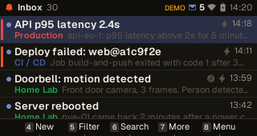
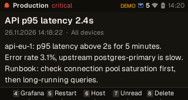
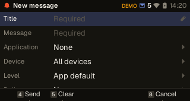
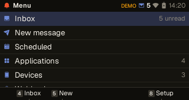
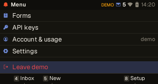
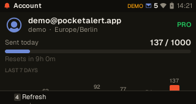
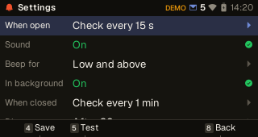
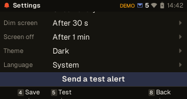
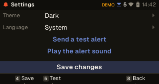

<div align="center">

# Pocket Alert for CardputerZero

**Your alerts on a pocket computer with a real keyboard.**

Read, send and manage Pocket Alert push notifications on the M5Stack CardputerZero. A background notifier beeps when something new arrives, even with the app closed.

[](LICENSE)

[Website](https://pocketalert.app) · [CLI](https://github.com/PocketAlert/cli) · [Releases](https://github.com/PocketAlert/CardputerZeroApp/releases)

 

</div>

## Features

- **Inbox.** Unread markers, level stripes, filters by application, search, unread only, mark read and delete.
- **Message actions.** `view` and `copy` buttons show the value with a QR code to scan on your phone. `http` buttons run the request after you confirm it.
- **Send alerts.** Set the title, text, application, device and level. Deliver now, after a delay or at a set time, with an image URL and up to 3 action buttons.
- **Manage everything.** Scheduled messages, applications, devices, webhooks with request history, forms, API keys, and your profile with today's usage.
- **Background notifier.** A small systemd user service checks for new alerts every minute and beeps. The minimum level that beeps is up to you.
- **Built for the device.** The app works without a mouse in 11 languages, has a dark theme and a pager LCD theme, and dims the screen to save battery.
- **Demo mode.** Try every screen with sample data, no account needed.

## Screenshots

| | |
|:---:|:---:|
| <br>Inbox | <br>Message with action buttons |
| <br>New message | <br>Menu |
| <br>Forms, API keys, account | <br>Account and today's usage |
| <br>Settings | <br>11 languages |
| <br>Theme, language and test alert | |

## Quick start

1. Install **Pocket Alert** from the CardputerZero app store, or [install the .deb](#install) by hand.
2. Open it from the launcher and sign in with one of these:
   - your email and password (2FA supported). The device gets its own API key named "Cardputer Zero".
   - an API key from [pocketalert.app/account/apikeys](https://pocketalert.app/account/apikeys).
   - the key of the [Pocket Alert CLI](https://github.com/PocketAlert/cli), if it is installed on the device.
3. A short tour shows the keys. Menu → Help & shortcuts brings it back at any time.

To get alerts on your phone as well, install the Pocket Alert app ([iOS](https://apps.apple.com/us/app/pocket-alert/id6446805143), [Android](https://play.google.com/store/apps/details?id=com.pocketalert.app)).

## Install

Download the latest `pocketalert-cardputer_*_arm64.deb` from [Releases](https://github.com/PocketAlert/CardputerZeroApp/releases), then:

```bash
scp pocketalert-cardputer_*_arm64.deb <user>@<device-ip>:/tmp/
ssh <user>@<device-ip> 'sudo apt install -y /tmp/pocketalert-cardputer_*_arm64.deb'
```

The package installs:

| Path | What |
|---|---|
| `/usr/bin/pocketalert_cardputer` | The app, shown in the launcher as "Pocket Alert" |
| `/usr/bin/pocketalert-notifyd` | The notifier, a systemd user service enabled for every account |
| `/usr/share/pocketalert_cardputer/` | Fonts, sounds and translations |

## Keys

| Key | Action |
|---|---|
| `4` `5` `6` `7` `8` | Actions in the bottom bar (the keys right under the screen) |
| `F` `X` or `fn+F` / `fn+X` | Up / down (plain letters work outside text fields) |
| `Z` `C` | Left / right, change an option |
| `Enter` | Open, edit a field, confirm |
| `Esc` | Back; hold to quit |
| `fn+L` / `fn+M` | Page up / down |
| `fn+H` | Keys for the current screen |
| `fn+J` | Screenshot to `~/Pictures/Screenshots` |

In the inbox: `R` read/unread, `D` delete, `U` unread only, `S` search, `N` new, `G` refresh.

## How alerts arrive

The Pocket Alert API has no push channel for non-mobile clients, so the app and the notifier poll for new messages:

- **App open:** every 15 s by default (Settings → When open). A new alert shows a toast, plays a sound and turns the screen back on.
- **App closed or screen off:** the notifier checks every minute (Settings → When closed) and beeps. It stays quiet while the app is open.
- **Errors:** failed checks back off, up to 5 min in the app and 10 min in the notifier.

## Settings

Settings covers the poll intervals (when open and when closed), sound, the minimum level that beeps, the background notifier, screen dim and screen off timeouts, theme, language, the tour at launch, and a test alert.

Everything is saved in `~/.config/pocketalert-cardputer/config.json` (mode `0600`) of the device's account. The app and the notifier share this file. When the launcher runs the app as root, the app uses the home of the account that owns the running user session.

### Battery

- The app sleeps on the keyboard and the network worker. When idle, it wakes about once a second.
- The backlight dims after 30 s without a key press and turns off after 1 min. Both timeouts are adjustable, or can be set to "Never". The first key press only wakes the screen.
- With the screen off, the app checks at the notifier's interval instead of every 15 s.

### Security

- API requests never follow redirects, so the key cannot leak to another host. The server must use `https://`.
- Action buttons that send a request show the method and the full URL, and run only after Enter. They get no credentials, only `http(s)` URLs, and at most 256 KB of response.
- Config and state files are written with the session user's ids, even when the app runs as root. The sound player runs as the session user with a minimal environment.

## Troubleshooting

```bash
journalctl --user -u pocketalert-notifyd -f   # notifier log
systemctl --user status pocketalert-notifyd   # is it running
pocketalert-notifyd --once --verbose          # one check by hand
sudo loginctl enable-linger $USER             # notifier starts at boot, not only after login
PA_KEYBOARD_DEVICE=/dev/input/event2 pocketalert_cardputer   # force a keyboard device
PA_FRAMEBUFFER=/dev/fb1 pocketalert_cardputer               # force the LCD framebuffer
```

## Languages

English, Deutsch, Español, Français, Indonesia, Italiano, 日本語, 한국어, Português, Русский and 简体中文. Pick one in Settings → Language. "System" follows `LC_ALL` / `LC_MESSAGES` / `LANG`, and falls back to English.

<details>
<summary><b>Development</b></summary>

Built with C++17 and LVGL 9.5 on top of the [CardputerZero Template](https://github.com/CardputerZero/Template).

### Simulator (macOS)

```bash
brew install cmake ninja libpng jpeg fmt sdl2 freetype
cmake --preset darwin-arm64
cmake --build --preset darwin-arm64-dbg
./build/darwin-arm64/Debug/pocketalert_cardputer --demo   # sample data, no account
./build/darwin-arm64/Debug/pocketalert_cardputer          # real account
```

The simulator takes your Mac keyboard (arrows, Enter, Esc, letters) and clicks on the pictured keys. `--demo` keeps its settings in `/tmp/pocketalert-cardputer-demo`.

`PA_SCRIPT` drives the simulator for smoke tests and screenshots:

```bash
PA_SCRIPT_DIR=/tmp/shots PA_SCRIPT="w2000 s:inbox enter w800 s:message esc 8 s:menu" \
  ./build/darwin-arm64/Debug/pocketalert_cardputer --demo
```

### Tests

```bash
./build/darwin-arm64/Debug/pa_tests

# under sanitizers (thread instead of address,undefined for races)
cmake --preset darwin-arm64 -B build/asan -DPA_SANITIZE=address,undefined
cmake --build build/asan --config Debug --target pa_tests && ./build/asan/Debug/pa_tests

# on Linux arm64, for the device-only code paths
docker run --rm --platform=linux/arm64 -v "$PWD":/src -w /src pocketalert-cardputer-build \
  bash -c 'cmake --preset cp0-docker -DPA_BUILD_TESTS=ON && cmake --build build/cp0-docker --config Release --target pa_tests && build/cp0-docker/Release/pa_tests'
```

Warnings are on for app code (`-Wall -Wextra -Wshadow …`); `-DPA_WERROR=ON` turns them into errors.

### Debian package

Needs Docker (OrbStack works). The build runs the unit tests and then packages the app in a Debian trixie arm64 container, the same OS as the device:

```bash
./build-deb.sh                            # dev: dist/pocketalert-cardputer_<ver>-1+dev<timestamp>_arm64.deb
RELEASE=1 ./build-deb.sh                  # release: dist/pocketalert-cardputer_<ver>-1_arm64.deb
CARDPUTER=<user>@<device-ip> ./deploy.sh  # copy the newest .deb to the device and install it
```

Every dev build gets a newer revision, so apt on the device upgrades to it.

### Release

The version lives in one place, `version` in `app-builder.json`; CMake reads it from there. `.github/workflows/release.yml` builds every push and pull request on an arm64 runner:

- **Pull request or manual run:** tests and builds a dev `.deb`, kept as a workflow artifact.
- **Push to main with a new version:** also creates the GitHub release `v<version>` with the `.deb` and its checksum, and publishes it to the CardputerZero store with `czdev publish`. Store updates merge automatically once the store's checks pass.
- **Push to main with an already released version:** only tests and builds.

```bash
scripts/bump-version.sh minor      # or patch, major, 1.2.0
git commit -am "chore: release v1.1.0"   # then merge into main
```

Store publishing needs the `CZDEV_TOKEN` secret: a classic GitHub token with the `public_repo` and `workflow` scopes, from the account that owns the app in the store. Without it the release still happens, and the workflow warns that the store was skipped.

### Translations

- Strings live in `assets/i18n/<locale>/<namespace>.json`, and code looks them up as `tr("<namespace>.<key>")`. English is the source, and a missing translation falls back to it. `i18n-limits.json` sets the maximum length of each string.
- Translations are made with the Pocket Alert website's script, which uses the Claude API. It only resends strings whose English changed (`i18n-lock/`).
- Geist has no CJK glyphs. The app draws ja/ko/zh from the system `fonts-noto-cjk` when it is installed, and otherwise from `assets/fonts/NotoSansCJK-UI.otf`, a subset with only the characters used in the translations. After changing ja/ko/zh strings, rebuild it with `tools/subset-cjk-font.py NotoSansCJKsc-Regular.otf`.
- `pa_tests` checks that every translation has only known keys and the same `{placeholders}`.

### Layout

```
src/core/      API client, models, parsing, config, demo backend, notifications (no LVGL)
src/ui/        screens, widgets, navigation, worker thread
src/platform/  keyboard (evdev + CardputerZero keymap), device status, screenshots
src/app/       startup, display, simulator frame
src/daemon/    pocketalert-notifyd
tests/         core unit tests
```

</details>

## License

[MIT](LICENSE). Fonts and icons keep their own licenses, see [assets/fonts/LICENSE.txt](assets/fonts/LICENSE.txt).
